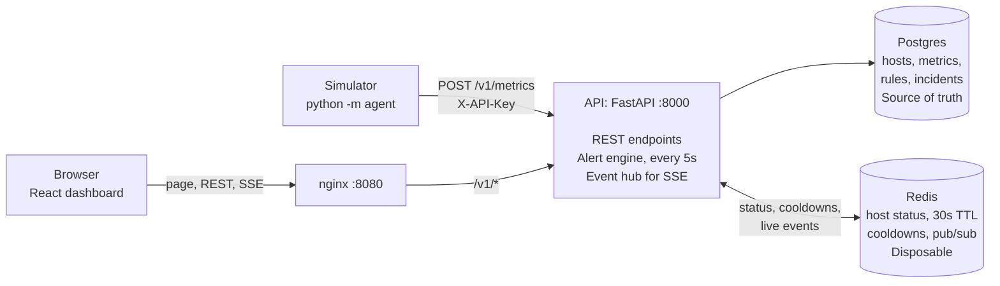

# Monitoring and Incident Dashboard

A small IT monitoring system. A simulator send metrics to a Python API. Alert rules turn sustained bad metrics into incidents, which move from open to acknowledged to resolved. A React dashboard shows host status, metrics and incidents live.

Built as a take-home project with Claude Code. [AI_WORKFLOW.md](AI_WORKFLOW.md) records how it was directed and checked, and [SPEC.md](SPEC.md) has the full design.

## Architecture



- **A host is down** when its Redis key has expired and Postgres shows no recent report.
- **An incident opens** only when a rule's condition has held for its full duration. A partial unique index means there is never more than one active incident per host and rule, however many evaluators run at once.
- **Incident status** changes in one module, `api/incidents.py`, which rejects invalid transitions. Incidents also resolve by themselves on recovery, and a cooldown stops them reopening straight away.

## Run it

You need Docker with Compose. Ports 5432, 6379, 8000 and 8080 must be free.

```bash
docker compose up --build
```

Then open:

- **Dashboard:** http://localhost:8080
- **API docs:** http://localhost:8000/docs

The first build takes about a minute, plus downloading the base images. This also starts a simulator with 5 healthy hosts, so the dashboard fills up by itself. The defaults, including the API key `dev-key`, are for local use only. Set `API_KEY` to change the key.

## Inject a fault

In a second terminal, swap the healthy simulator for one with faults, and watch the dashboard:

```bash
docker compose stop agent
docker compose run --rm agent --hosts 5 --spike-cpu host-3 --stop host-2
```

- After about 35s, a `High CPU` incident opens for host-3.
- After about 55s, host-2's tile turns red and a `Host down` incident opens. It stops reporting after 20s, and the status key then has a 30s TTL. Use `--stop-after` to change the delay.
- Try **Ack** and **Resolve**. If you resolve while CPU is still high, a new incident opens once the 60s cooldown ends.

Press Ctrl+C to end it, then bring the healthy simulator back. The remaining incidents resolve by themselves:

```bash
docker compose start agent
```

All flags: `docker compose run --rm agent --help`.

## Use the API

On Windows PowerShell, type `curl.exe` instead of `curl`, or use the API docs page, since PowerShell's quoting makes these JSON bodies awkward.

```bash
# Send metrics. ts is optional, and defaults to the server's time.
curl -X POST localhost:8000/v1/metrics -H "X-API-Key: dev-key" -H "Content-Type: application/json" \
  -d '{"samples":[{"host_id":"web-1","name":"cpu","value":42.5},{"host_id":"web-1","name":"mem","value":61}]}'

# Host status and latest values, and one metric's history
curl localhost:8000/v1/hosts
curl "localhost:8000/v1/metrics?host_id=web-1&name=cpu"

# Incidents, then acknowledge and resolve one, using an id from the list.
# An invalid move, such as acknowledging twice, returns 409.
curl "localhost:8000/v1/incidents?status=open"
curl -X POST localhost:8000/v1/incidents/1/ack
curl -X POST localhost:8000/v1/incidents/1/resolve

# Alert rules: list them, and add one
curl localhost:8000/v1/rules
curl -X POST localhost:8000/v1/rules -H "Content-Type: application/json" \
  -d '{"name":"Low disk","metric":"disk","op":"<","threshold":10,"duration_secs":60}'
```

Rules can also be changed with `PUT /v1/rules/{id}` and removed with `DELETE /v1/rules/{id}`. To watch live events, run `curl -N localhost:8000/v1/events`.

## Run the tests

The tests use real Postgres and Redis, and need Python 3.12. They keep to their own databases and Redis DB, so they're safe to run while the stack is up.

```bash
python -m venv .venv
source .venv/bin/activate    # Windows PowerShell: .venv\Scripts\Activate.ps1
pip install -r requirements-dev.txt
docker compose up -d postgres redis
pytest
```

CI runs the same tests, plus `ruff format --check .`, `ruff check .`, `mypy`, and `npm ci && npm run build` in `web/`.

## AI-assisted workflow

**Tools:** Claude Code (VS Code extension) with Claude Opus 5.5. Claude wrote the code. I set the scope, approved the plans and made the decisions.

**Key steps:**

1. I wrote the scope, code standards and required tests in `CLAUDE.md`, and approved Claude's plan in `SPEC.md` before any code was written.
2. We worked through 10 phases in order, from the skeleton to this README. For each one, Claude proposed a short plan, I approved it, and Claude built it, ran it and showed the command output as evidence.
3. Each phase ended with an update to `AI_WORKFLOW.md`, including every problem found in Claude's output, followed by a pause for my review and a commit.

**Time spent:** about 2h 45m of phase time, computed from the logged timestamps and spread over three days. That starts from when I started the project on 2026-11-01.

**How the result was checked:**

- 246 tests against real Postgres and Redis, including the required idempotency, flapping, host-down and state machine tests. They also pass under heavy CPU load in random order, and GitHub Actions runs the suite on every push.
- 75 deliberate code breaks, to prove the tests can fail. This exposed several weak tests.
- Fault injection on the running stack, and a real browser driving the dashboard, including clicking Ack and Resolve.
- Real outages of Postgres, Redis and the API while everything was running.

These checks found 42 logged problems in Claude's output. They include fixes that made things worse, claims that were false when measured, and a 500 during a real Postgres outage that passing tests had missed. The full account is in [AI_WORKFLOW.md](AI_WORKFLOW.md).

## Known limitations

**Out of scope for this project:**

- No user accounts, and no auth on the dashboard endpoints. Only ingest requires a key, so anyone who can reach the API can acknowledge incidents or change rules.
- No multi-tenancy, notifications or Kubernetes.

**Accepted trade-offs:**

- Metrics are kept forever, with no retention or downsampling. The simulator adds about 7.5 rows per second.
- Metrics sent while Postgres is down are lost, not queued, so the chart shows a gap.
- `GET /v1/incidents` returns only the newest 200, with no pagination.
- A single API instance and worker is assumed, with no leader election for the alert engine. Duplicate engines are still safe, because incident creation is idempotent in the database.
- A Redis subscription connection that dies with no TCP close isn't detected, so live updates would stop until the API restarts. A normal Redis restart is handled.
- There are no automated frontend tests. CI only checks that the frontend compiles. The dashboard was checked with a one-off browser script that isn't in this repo.
- Incident ids have gaps, because `ON CONFLICT DO NOTHING` uses up a sequence value each time.
